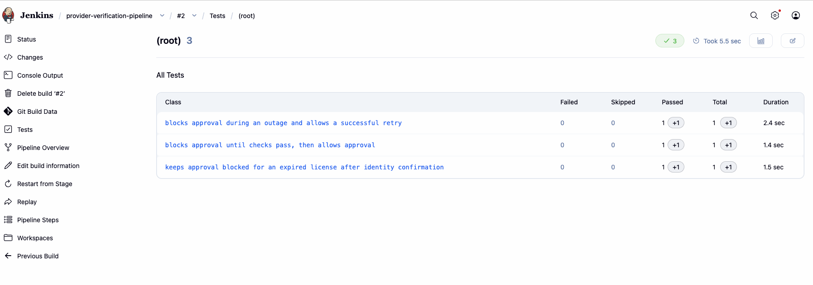

# Provider Verification System

A React and TypeScript demo of a provider verification workflow for a Trust & Safety team.

The application demonstrates verification checks, manual identity review, approval controls, and decision history using fictional providers and simulated results.

The frontend also retrieves fictional provider records from an Express API hosted on Render, with loading and error states. These records are separate from the simulated verification applications.

## Features

- Simulated identity and license checks.
- Manual review of identity mismatches, with a required reason.
- Provider approval after eligibility requirements are met.
- Application rejection with a recorded reason.
- Approval blocked when a license is expired.
- Simulated verification service outages and retry support.
- Decision history recording timestamps, actors, actions, and reasons.

## Demo Providers

| Provider | Identity Check | License Check |
| --- | --- | --- |
| Dr. Jordan Smith | Match | Active |
| Dr. Taylor Lee | Mismatch | Active |
| Dr. Morgan Davis | Mismatch | Expired |

## Approval Rules

A provider is eligible for approval only when:

- The license check returns active.
- Identity matches or has been confirmed through manual review.
- The application has not been rejected.
- Verification checks have completed successfully.

Confirming identity does not override an expired license.

## Run Locally

Requires Node.js and npm.

Install dependencies:

    npm install

Start the development server:

    npm run dev

Open the local URL displayed in the terminal.

Build the project:

    npm run build

## Manually Tested Scenarios

- Successful verification followed by approval.
- Identity mismatch resolved through manual review.
- Rejection with a recorded explanation.
- Verification service outage followed by a successful retry.
- Expired license continues to block approval after identity confirmation.

## Demo Limitations

All provider information and verification results are fictional.

Simulated verification state and decision history are held in frontend memory and reset when the page is refreshed. The Express API serves fictional records from memory and does not yet use a database.

Production use would require backend enforcement of approval rules, authenticated reviewers, access controls, durable audit records, and integrations with authoritative verification sources.

## Technology

- React
- TypeScript
- Vite
- CSS
- Node.js
- Express
- Cypress
- Render
- GitHub Actions

## Automated Testing and Jenkins CI

The project includes eight Cypress tests:

- Three verification workflow tests covering approval safeguards, expired licenses, and outage recovery.
- Two frontend API tests using simulated responses to check provider display and network errors.
- Three direct API tests checking service health, provider response fields and statuses, and 404 handling.

Verified locally: **8 tests passed, 0 failed.**

### Jenkins pipeline

The pipeline is defined in the version-controlled Jenkinsfile. Each run:

1. Checks Node and npm versions.
2. Installs dependencies using npm ci.
3. Runs ESLint.
4. Builds the application with TypeScript and Vite.
5. Starts a local preview server and runs Cypress in Chrome.
6. Publishes JUnit test results and archives failure screenshots.
7. Archives the application build when all checks pass.

Earlier Jenkins result: **3 tests passed, 0 failed, 0 skipped.** The expanded eight-test suite was verified locally.

### Run locally

Requires Node.js compatible with the project and Google Chrome.

npm ci
npm run lint
npm run build
npm run test:e2e

Direct API tests also require the backend to be running at the apiUrl configured in cypress/e2e/api-endpoints.cy.js.

The test command starts the preview server, waits for it to respond,
runs Cypress, and stops the server afterward.

## Contributing

Contributions and suggestions are welcome.

- Read [Contributing](CONTRIBUTING.md) for setup, testing, and pull request guidance.
- Follow the [Code of Conduct](CODE_OF_CONDUCT.md).
- Use the issue templates to report bugs or suggest features.
- Follow the [Security Policy](SECURITY.md) to report vulnerabilities.

## Deployment

The React frontend is deployed from main to GitHub Pages through GitHub Actions. The Express backend is deployed from main to Render.

The frontend build uses VITE_API_URL to connect to the hosted API.

Jenkins runs separately on my Mac and is triggered manually. The GitHub Pages workflow builds and deploys the frontend but does not run Cypress or wait for Jenkins results.

[Try the live demo](https://cycalona-villani.github.io/provider-verification-system/)

[API health check](https://provider-onboarding-api.onrender.com/api/health)

